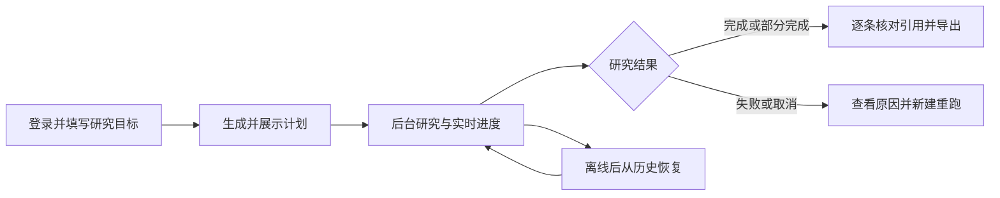
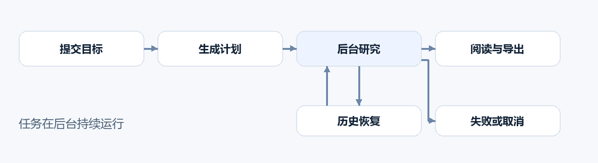
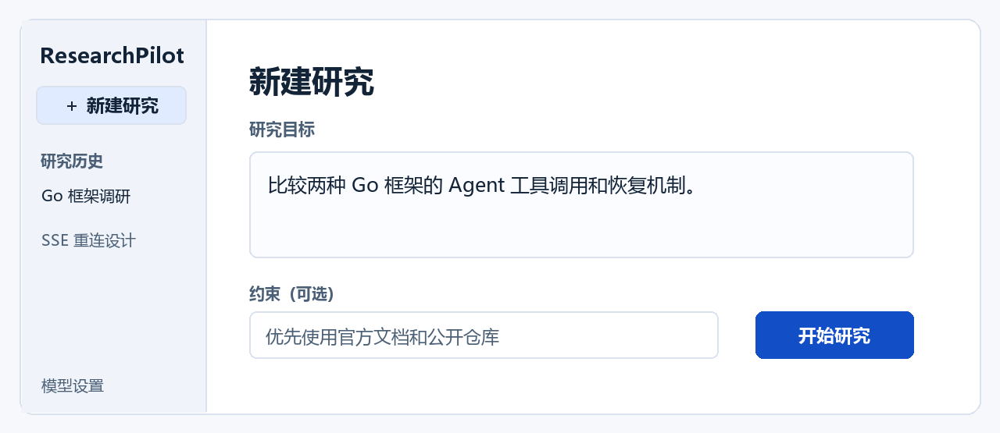
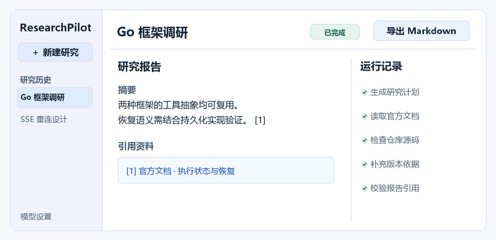

# 产品需求与用户体验

## 用户与成功标准

开发者可比较框架和开源实现，技术负责人可复查建议依据。报告覆盖问题、比较维度、结论、局限和来源。用户可看到系统处于规划、研究、重试或生成报告，断开浏览器或关闭桌面窗口后可在同一账号下继续查看。

## 范围

| 阶段 | 功能 |
|---|---|
| MVP / P0 | 注册登录与会话、创建任务、自动规划与只读三工具、实时进度及重连、取消、报告引用、历史、Markdown 导出、单活跃模型配置、Web 与 Windows 安装包。 |
| P1 | 编辑或审批计划、多轮追问、偏好记忆、PDF 导出、多配置切换、GitHub 目录与依赖深度分析、上传资料、macOS 分发。 |
| P2 | 多 Agent 分工、多任务并行工作区、定时研究与订阅、MCP 工具接入、运行成本分析与评估面板。 |

原对话流程图包含手动审批，功能列表把编辑计划放在 P1。本稿建议 P0 自动执行且计划可见，审批与编辑一起进入 P1。P0 的技术入口保留计划版本号，避免审批旧计划。产品不执行第三方代码、不修改仓库，P0 聚焦公开技术资料。用户关闭客户端不会改变任务状态。

## 工作台与报告原型

**新建研究。** 左栏提供历史，主区收集研究目标和比较约束，设置入口管理模型。提交期间禁用重复点击并复用幂等键。空标题、无可用模型和配额用尽分别在表单中说明。

**执行与报告。** 桌面和宽屏 Web 共用布局，报告区与运行面板约 65:35。窄屏将执行面板收为抽屉。顶栏展示可信状态、耗时和取消入口；时间线展示工具、结果摘要与重规划原因。断线期间显示重连，报告保留缺证或证据冲突标记。点击引用展示标题、片段、时间、URL 或固定提交；键盘可到达所有操作，状态用文本与颜色共同表示。
