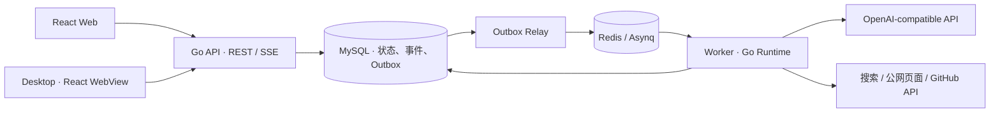
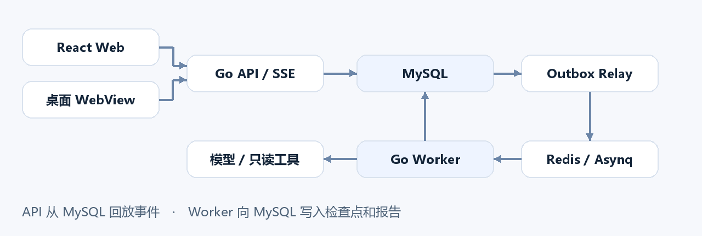

# 系统架构

Go 模块化单体按 API 与 Worker 两个进程部署。API 管理认证、任务、报告和 SSE；Worker 管理计划、工具执行、采证及报告写入。以 Go 接口隔离 HTTP、存储、模型和工具。统一 React 工作区经平台适配层处理登录、保存文件和外部链接。

MySQL 保存执行事实。Redis 承载 Asynq 队列、限流和可选的事件唤醒，队列、缓存建议分实例或至少分资源配额，避免缓存淘汰误伤关键队列。SSE 回放和报告查询均从 MySQL 读取。Compose 部署反向代理、Web 静态站点、API、Worker、Outbox 扫描器和数据服务。仓库建议使用 apps/api、apps/worker、apps/web、apps/desktop、packages/ui、internal/agent、internal/tools、migrations、deployments、docs。

## 信任边界

所有工具都由服务端 allowlist 注册。Worker 与转发器通过不同凭证连接 MySQL 和 Redis。API 可写用户配置与任务，但读取模型密钥的解密能力由工作进程和受限的配置探测路径持有。用户给定的目标、网页、GitHub 内容和模型输出均按不可信输入处理。

- **SSRF。** 出站代理和应用同时实施限制。仅允许解析规范的 HTTP(S) URL，拒绝用户信息、歧义地址和不允许的出站端口。校验 DNS 所有结果，连接时绑定经验证的公网 IP，保持原 Host/SNI，每跳重定向重复校验，拒绝环回、私网、链路本地、保留网段及内部 DNS。限跳转、响应时间、类型及解压后体积。模型 Base URL 使用同一原则，并由管理员配置允许域名，携带密钥的模型请求禁跟随重定向。
- **提示注入。** 来源正文按数据字段传给模型，保留来源标记；运行时独立检查工具名、参数、权限与预算。工具只读无 shell，密钥和系统指令独立于上下文。报告禁用原始 HTML，清洗 Markdown 链接，图片默认禁远程加载。桌面限制 IPC 权限和 WebView 导航。
- **密钥。** API key 写入后只返回掩码或已配置标记。以 AES-GCM 信封加密，随机 nonce，绑定 tenant_id 和配置 ID 作为 AAD；主密钥在外部密钥服务或受限部署密钥存储，存 key version 并演练轮换。日志、错误、SSE、前端和队列均禁止明文密钥。
- **租户。** P0 每个用户拥有一个个人租户。登录身份推导 tenant_id，每条访问路径含租户条件，包含 SSE、报告及引用。Worker 根据任务持久记录校验租户，Redis 键按环境和租户命名。密码用 Argon2id，登录、注册和创建任务限流，退出撤销刷新会话。备份和调试访问同样受限。
