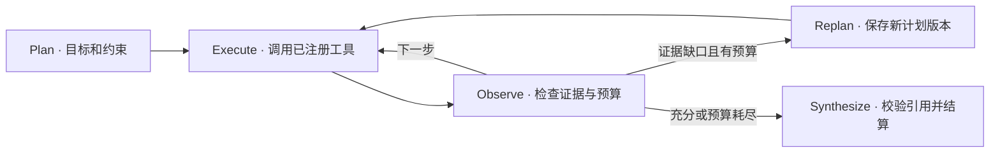

# Agent Runtime 与模型工具

## 执行循环

Plan 输出有版本的结构化步骤，包括目标、工具候选、预期证据和依赖，应用验证模式和预算后保存。Execute 按步骤派发，经 schema、allowlist、租户策略和超时检查。Observe 将结果规范化为证据，去重并检查比较维度是否有支撑；日志向用户展示“缺少版本证据”等短理由。Replan 生成未执行部分的新版本，已提交的产物仍可回查。收口将报告中的 Source ID 映射到真实来源，校验归属及引文定位，未支持的主要结论降级或移除。

每任务建议上限 12 个逻辑步骤、3 次重规划、5 分钟、40k 总 Token，配置可下调；每个工具独立超时与限流。跨重试以数据库原子预留预算，已知实际用量再结算，未知用量按保守估算标记。成功有足够证据，部分完成需有可用证据及明确缺口，无证据且无法恢复则失败。短期记忆为已提交计划、摘要与证据 ID。P1 会话和偏好进入 MySQL，提供查看、删除与按任务启用。

## 工具注册表

| 工具 | 输入与输出 | MVP 边界 |
|---|---|---|
| web_search | query、limit，返回标题、规范 URL、摘要、时间和 provider | 用统一适配器换供应商。摘要用于发现，进入报告前优先读原文。 |
| fetch_page | 公网 URL，返回标题、干净正文、时间、摘要及哈希 | 默认 HTML/文本，保留原始和最终链接；限制体积与字符，执行出站策略。 |
| github_repo | owner、repo、可选 path，返回 README、目录摘要和依赖清单摘录 | 限公开仓库，默认分支解析为 commit SHA，关键引用指向固定提交。不克隆或执行代码。 |

统一契约 Tool 接受服务端作用域、带时限的 Context 和已校验的 JSON。结果含 evidence、retrieved_at、truncated、error_code。保存最小证据片段，超限、429 与不可用结果转为结构化观察。GitHub API 处理额度和 Retry-After，工具缓存按授权边界与 commit 键控。GitHub 分析按固定提交查看嵌套目录和依赖清单，可指定仓库内目录。每次最多读取六份清单，跨目录概览和清单读取均受大小限制。Git 树超限时仅列出当前目录，并标注覆盖范围。[GitHub Contents API](https://docs.github.com/en/rest/repos/contents)

## 模型供应商抽象

Runtime 使用 Chat(ctx, req) 和 ChatStream(ctx, req)；请求含 messages、tool schema、最大输出和可选结构化输出，统一响应含文本、工具调用、usage 与 finish_reason。OpenAI-compatible 适配器以 Chat Completions 为首个协议，取配置快照和密钥版本。设置保存时用同租户探测所需能力，区分基础对话、工具调用、结构化输出和流式工具片段。有能力差异时在配置页面明确标记；允许受限 JSON 模式适配，始终执行服务端 schema 校验。供应商错误归一为认证、限流、超时、不兼容或上游失败。只在安全的边界限次重试；记录供应商请求 ID，禁止静默跨供应商发送数据。[OpenAI Chat API](https://developers.openai.com/api/reference/resources/chat)
