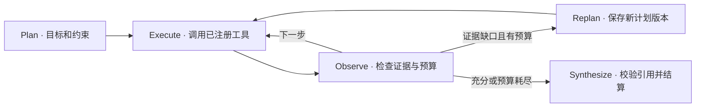
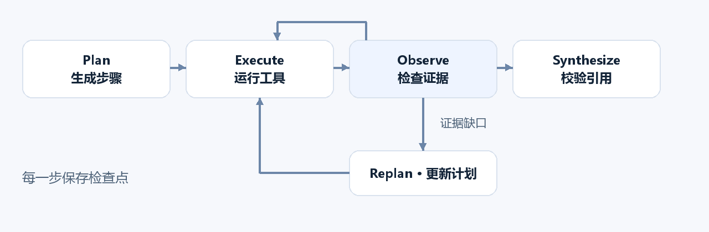

# Agent Runtime 与模型工具

## 执行循环

Plan 输出有版本的结构化步骤，包括目标、工具候选、预期证据和依赖，应用验证模式和预算后保存。Execute 按步骤派发，经 schema、allowlist、租户策略和超时检查。Observe 将结果规范化为证据，去重并检查比较维度是否有支撑；日志向用户展示“缺少版本证据”等短理由。Replan 生成未执行部分的新版本，已提交的产物仍可回查。收口将报告中的 Source ID 映射到真实来源，校验归属及引文定位，未支持的主要结论降级或移除。

每轮最多并行执行两个可运行的取证步骤。依赖步骤先落库，下游在依赖取得证据后才调用工具。依赖失败会记录为跳过，独立分支仍可继续。检查点按计划版本和步骤 ID 保存，恢复时复用已提交的结果。观察与报告综合按计划顺序读取证据。

启用引用复核后，Eino 在草稿生成与报告发布之间执行独立的审阅阶段。审阅使用同一任务的模型和预算，输入限于草稿和它所引用的摘录。审阅只返回逐项通过或移除的决定，结果保存为检查点。移除部分结论时发布部分报告。如果所有结论都缺乏支持，使用现有的资料摘录回退流程。

每任务建议上限 12 个逻辑步骤、3 次重规划、5 分钟、40k 总 Token，配置可下调；每个工具独立超时与限流。跨重试以数据库原子预留预算，已知实际用量再结算，未知用量按保守估算标记。成功有足够证据，部分完成需有可用证据及明确缺口，无证据且无法恢复则失败。短期记忆为已提交计划、摘要与证据 ID。P1 会话和偏好进入 MySQL，提供查看、删除与按任务启用。

## 研究预算分配

单任务默认总预算仍为 40,000 Token。调用前继续用提示词 UTF-8 字节数加 1,024 的开销和实际请求的输出上限做保守预留，调用后按供应商返回的用量结算。各阶段的 `max_tokens` 分别设置，预留与实际发送的参数一致：

| 模型阶段 | 输出上限 | 留给后续阶段的预算 |
| --- | ---: | ---: |
| 规划与计划修复 | 1,536 | 16,000 |
| 证据覆盖检查与 JSON 修复 | 768 | 16,000 |
| 可选证据分析笔记 | 768 | 16,000；不足时跳过笔记 |
| 报告生成与修复 | 4,096 | 需要引用审核时保留 6,000 |
| 引用审核 | 256 | 0 |

保留额度属于原有总预算，数据库在同一个原子条件更新中校验已用、预留、本次调用及后续保留额度；对于较小的任务总预算，后续保留额度最多占一半。证据覆盖检查、报告生成和引用审核在预留不通过时，先缩减归档证据摘录再尝试；不会因为同一预留失败重复调用模型或计费。引用审核保留所有待审结论与来源 ID，只压缩其证据摘录，不跳过审核。

如果继续规划或检查证据将挤占收尾额度，且任务已有归档资料，则结束采集、保留未解决的证据缺口，继续生成并审核部分结论。运行记录显示 `report_budget_reserved` 事件，被预算阻止的未完成步骤结束为 ABANDONED。没有可用资料或剩余额度仍不足以完成必要调用时，继续使用原有失败与资料摘录回退规则；预留额度不保证任意长度输入都能完成。

## 工具注册表

| 工具 | 输入与输出 | MVP 边界 |
|---|---|---|
| web_search | query、limit，返回标题、规范 URL、摘要、时间和 provider | 用统一适配器换供应商。摘要用于发现，进入报告前优先读原文。 |
| fetch_page | 公网 URL，返回标题、干净正文、时间、摘要及哈希 | 默认 HTML/文本，保留原始和最终链接；限制体积与字符，执行出站策略。 |
| github_repo | owner、repo、可选 path，返回 README、目录摘要和依赖清单摘录 | 限公开仓库，默认分支解析为 commit SHA，关键引用指向固定提交。不克隆或执行代码。 |
| microsoft_docs_search | query 为预设主题 ID，经 MCP 返回至多五条 Microsoft Learn 摘录 | 默认关闭。Worker 启用后通过固定 HTTPS 端点执行只读查询，出站参数由主题映射生成。 |

统一契约 Tool 接受服务端作用域、带时限的 Context 和已校验的 JSON。结果含 evidence、retrieved_at、truncated、error_code。保存最小证据片段，超限、429 与不可用结果转为结构化观察。GitHub API 处理额度和 Retry-After，工具缓存按授权边界与 commit 键控。GitHub 分析按固定提交查看嵌套目录和依赖清单，可指定仓库内目录。每次最多读取六份清单，跨目录概览和清单读取均受大小限制。Git 树超限时仅列出当前目录，并标注覆盖范围。[GitHub Contents API](https://docs.github.com/en/rest/repos/contents)

对 GitHub 实现行为的研究可以先用 `github_repo` 找到固定提交与文件路径，再用 `fetch_page` 读取固定提交的 `blob` 链接。工具读取有大小限制的公开文本，并以固定提交链接归档源码摘录。重规划收到有界的目录线索，报告优先采用能直接支撑行为结论的源码。若报告合成的预算预留失败，会在同一步使用较短摘录再尝试，沿用原任务预算和引用校验。

## 模型供应商抽象

Runtime 使用 Chat(ctx, req) 和 ChatStream(ctx, req)；请求含 messages、tool schema、最大输出和可选结构化输出，统一响应含文本、工具调用、usage 与 finish_reason。OpenAI-compatible 适配器以 Chat Completions 为首个协议，取配置快照和密钥版本。设置保存时用同租户探测所需能力，区分基础对话、工具调用、结构化输出和流式工具片段。有能力差异时在配置页面明确标记；允许受限 JSON 模式适配，始终执行服务端 schema 校验。供应商错误归一为认证、限流、超时、不兼容或上游失败。只在安全的边界限次重试；记录供应商请求 ID，禁止静默跨供应商发送数据。[OpenAI Chat API](https://developers.openai.com/api/reference/resources/chat)
