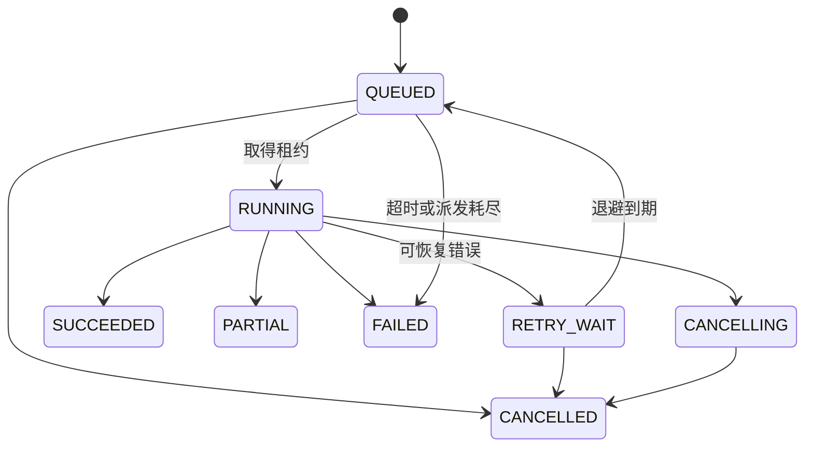
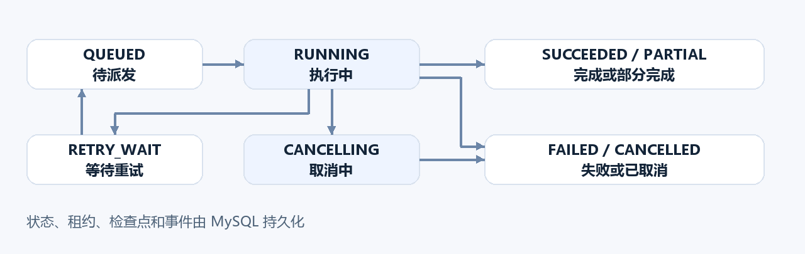
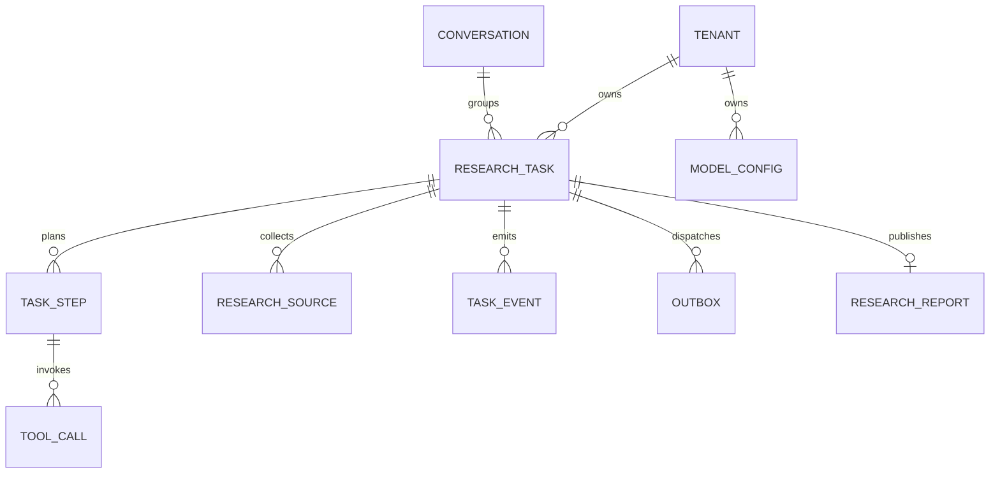

# 数据与持久执行

任务状态用于用户界面与调度。运行内部 phase 为 planning、executing、observing、replanning、synthesizing；P1 再引入 waiting_approval。终态不可逆，重跑创建新任务并引用原任务。取消先落库，运行中传递 Context 取消，最后由 Worker 或租约回收器结算。取消与完成竞争由行锁和合法迁移决定，先提交的合法终态生效。

| 表 | 关键约束和内容 |
|---|---|
| users / tenants / sessions | 每用户个人租户；会话存刷新令牌哈希、到期和撤销时间。 |
| conversations / research_tasks | 租户 FK，任务保存 goal、status、phase、revision、plan_version、lease_epoch、lease_until、deadline、预算和 provider 配置版本；索引 tenant_id + created_at 和 status + lease_until。 |
| task_steps / tool_calls | 计划版本、逻辑步骤、尝试编号、执行状态和错误；逻辑调用键唯一，尝试记录可审计。 |
| research_sources / research_reports | 租户及任务复合外键；来源含规范 URL、commit SHA、片段、哈希、抓取时间；报告保存内容版本与引用映射。 |
| task_events / outbox / request_keys | 任务内单调 seq 唯一，outbox 有可回收租约、退避时间，幂等键按租户和操作唯一并校验请求摘要。 |
| model_configs / model_usages | 配置版本、密钥版本及密文，记录调用、用量、估算标记；后续追加 user_memories / messages。 |

## 核心实体关系

每份已发布报告归属于一个任务，引用指向该任务下的不可变证据记录。业务表之间的复合外键带 tenant_id，阻止错误关联跨租户数据。

## 恢复协议

1. API 用单次 MySQL 事务写入任务、初始事件、幂等记录及 outbox 后返回 202。转发器按派发代次向 Asynq 入队，成功后标记 outbox；中途宕机可重复投递。对长时间未开始任务做 MySQL 对账并重新派发，覆盖 Redis 数据丢失场景。
2. Worker 按条件更新取得租约及单调递增的 fencing epoch，定期续租。所有状态、检查点、事件和报告提交带当前 epoch、合法状态及有效期。过期 Worker 的写入失效，回收器在预算和 deadline 内重派。
3. 以任务、计划版本、逻辑步骤和调用号定位已提交结果。模型或 HTTP 调用在提交前中断可重复，按至少一次设计，外部计费可能重复。按原子预算预留、尝试上限和保守结算约束；队列确认在检查点或终态提交后。
4. 可恢复错误持久化为 RETRY_WAIT，同时写定时 outbox，使用指数退避加抖动并考虑 Retry-After。任务层统一管理可见重试，队列重试用于基础设施故障。不可恢复错误与重试耗尽记录可读原因。进度与状态在同事务写事件，报告和终态同事务落库。[Asynq 上游](https://github.com/hibiken/asynq)
